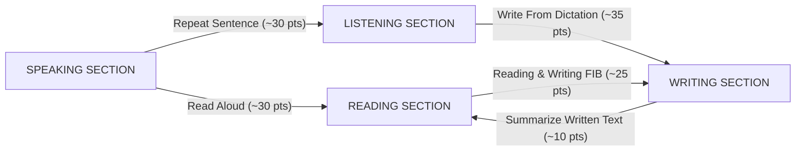

# PTE ACADEMIC 79+ MASTER PLAYBOOK: SUPERIOR ENGLISH (20 POINTS)
**Candidate:** Eng. Hossam Ahmed Zein Abdelhamid Bassiuny  
**Nominated Target:** PTE Academic 79+ in each of the 4 components (Listening, Reading, Speaking, Writing)  
**Australian Skilled Migration Equivalency:** IELTS Band 8.0+ / Superior English = **20 Maximum Migration Points**  

---

## 1. THE BIG SECRET OF PTE: CROSS-MODULE SCORING ALGORITHM

Unlike IELTS where each skill is tested in an isolated bubble, **PTE Academic is an interconnected AI ecosystem**. A single question in the Speaking section can give you more Reading points than the Reading section itself!

### The "Big Four" Questions (Determine 70% of Your Total Score):
If Eng. Hossam masters just these 4 question types, achieving **79+ is virtually guaranteed**:
1. **Write From Dictation (WFD) - Listening Section:** Gives ~35 points to Listening and ~35 points to Writing!
2. **Repeat Sentence (RS) - Speaking Section:** Gives ~30 points to Speaking and ~25 points to Listening!
3. **Read Aloud (RA) - Speaking Section:** Gives ~30 points to Speaking and ~30 points to Reading!
4. **Reading & Writing Fill in the Blanks (R&W FIB) - Reading Section:** Gives ~25 points to Reading and ~25 points to Writing!

---

## 2. THE UNIVERSAL TESTED TEMPLATES (GUARANTEED 79+)

PTE is graded by Pearson's machine-learning algorithm. The algorithm does not care about "creativity"; it measures **Oral Fluency, Pronunciation, Grammar, and Structure**. Memorizing these exact templates guarantees top marks.

---

### TEMPLATE 1: WRITE ESSAY (Universal 90/90 Template)
*Word Count: Exactly 210 – 240 words.*  
*Usage: Plug in **Topic**, **Keyword 1**, and **Keyword 2** from the prompt.*

> **"These days, the issue of [TOPIC] has sparked considerable debate in contemporary society. While some individuals argue that [KEYWORD 1] plays a pivotal role in this domain, others maintain that [KEYWORD 2] has far-reaching consequences. This essay will examine both perspectives before presenting a reasoned conclusion.**
>
> **First and foremost, it is undeniable that [KEYWORD 1] offers numerous advantages. Primarily, when individuals or institutions actively engage with this phenomenon, it fosters substantial socioeconomic development and practical efficiency. Furthermore, extensive empirical studies demonstrate that prioritizing this aspect significantly enhances overall productivity and individual well-being. A pertinent example of this is observed in modern technological and industrial sectors, where systematic implementation yields remarkable outcomes.**
>
> **On the other hand, proponents of alternative approaches contend that [KEYWORD 2] is of equal significance. They assert that neglecting this critical dimension can lead to unforeseen challenges and structural imbalances. Consequently, establishing robust frameworks and comprehensive guidelines is essential to maintain sustainable progress across all operational levels.**
>
> **In conclusion, both [KEYWORD 1] and [KEYWORD 2] are integral components of this multifaceted issue. In my opinion, striking a harmonious balance between these two elements is of paramount importance to ensure continuous advancement and long-term societal prosperity."**

---

### TEMPLATE 2: DESCRIBE IMAGE (Universal Speaking Template - 25 Seconds)
*PTE AI does not check if your numbers are 100% accurate; it checks if your speech is **smooth, continuous, and without pauses**!*

> **"The given image provides informative details regarding [Title of Image / Chart].**  
> **Looking at the overall trends, it is clearly evident that there are several distinct categories shown in the diagram.**  
> **According to the illustration, the highest figure can be observed in [First element/number], which is remarkably significant.**  
> **Conversely, the lowest value is registered in [Second element/number], showing a noticeable contrast.**  
> **Furthermore, fluctuating patterns can also be detected throughout the entire observation period.**  
> **In conclusion, this illustration offers comprehensive and valuable insights into the designated topic."**

*(Speak at a natural, steady pace. Finish speaking between 25 and 32 seconds, then click Next immediately).*

---

### TEMPLATE 3: RE-TELL LECTURE (Keyword Capture Formula)
*During the audio, write down **6 to 8 strong nouns/phrases** on your erasable notepad (e.g., climate change, solar energy, battery storage, carbon emissions).*

> **"The speaker provided an engaging and informative lecture regarding [Keyword 1].**  
> **Initially, the speaker placed significant emphasis on [Keyword 2], explaining its core mechanisms.**  
> **Subsequently, the discussion highlighted the crucial role of [Keyword 3] and its direct connection to [Keyword 4].**  
> **Furthermore, the speaker pointed out essential data concerning [Keyword 5], demonstrating major historical trends.**  
> **Finally, the lecture underscored the profound implications of [Keyword 6].**  
> **In conclusion, the presentation delivered a comprehensive overview of this subject."**

---

### TEMPLATE 4: SUMMARIZE WRITTEN TEXT (1 Single Sentence Formula)
*Rule: You MUST write **ONLY ONE SENTENCE** between 35 and 45 words ending with ONE full stop.*

> **"[Main Idea 1], which plays a crucial role in [Field/Topic], because [Reason/Idea 2], and this ultimately demonstrates that [Idea 3]."**

---

### TEMPLATE 5: SUMMARIZE SPOKEN TEXT (Listening - 50 to 70 Words)
> **"The speaker provided an insightful lecture regarding [Topic/Keyword 1]. Initially, the discussion focused on [Keyword 2] and its fundamental importance. Furthermore, the speaker highlighted the significant impact of [Keyword 3] alongside [Keyword 4]. Finally, the presentation emphasized the ongoing developments related to [Keyword 5]. In conclusion, the lecture offered a comprehensive understanding of this critical subject."**

---

## 3. THE 30-DAY ENGINEERING ROADMAP FOR ENG. HOSSAM (79+ TARGET)

### Platform: **APEUni (Web / App: apeuni.com)**
*APEUni is the world's #1 PTE AI practice platform. It replicates Pearson's scoring engine with 98% accuracy.*

| Week | Focus Area | Daily Target (60–90 mins) |
|---|---|---|
| **Week 1** | **Speaking Domination (RA, RS, DI)** | • 20 Read Aloud (focus on steady tempo, no hesitations) • 30 Repeat Sentence (memorize half, mimic intonation) • 10 Describe Image (using Template 2) |
| **Week 2** | **Writing & The Goldmine (WFD)** | • Memorize Write Essay Template (type it in under 12 mins) • 30 Write From Dictation (WFD) daily from APEUni Real Exam Prediction • 10 Summarize Written Text |
| **Week 3** | **Reading Collocations & Blanks** | • 25 Reading & Writing Fill in the Blanks (R&W FIB) • 20 Reading Fill in the Blanks (Drag & Drop) • Continuous daily drilling of 40 WFD |
| **Week 4** | **Full Scored Mock Exams & Speed** | • Take 2 Full-Length Scored Mock Tests on APEUni • Error analysis on missed WFD words and spelling • Target mock score: 82+ to guarantee 79+ in the real exam |

---

## 4. HOW ENG. HOSSAM INTERACTS WITH HIS DEDICATED AI TUTOR:

Whenever Eng. Hossam sits down to practice, he simply types:  
`"أنا حسام، يلا نبدأ تدريب PTE"`

The system will instantly:
1. Fire up the dedicated **`pte_master_tutor`**.
2. Run live **Write From Dictation** spelling drills.
3. Test his **Read Aloud** pace and cadence.
4. Review and grade his essays against Pearson's AI scoring criteria.
